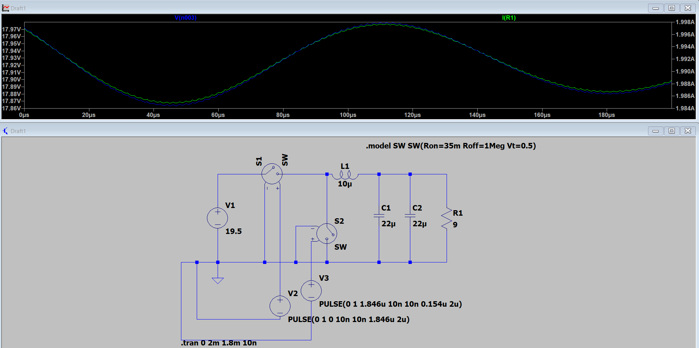
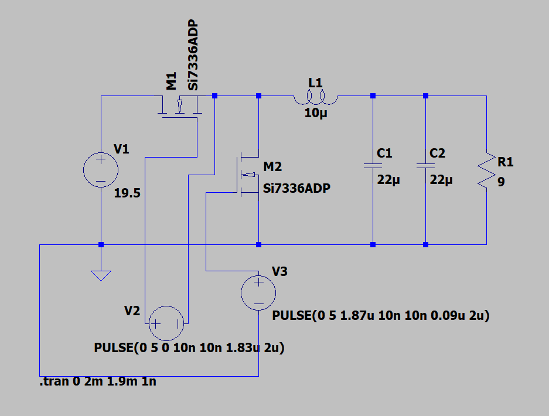
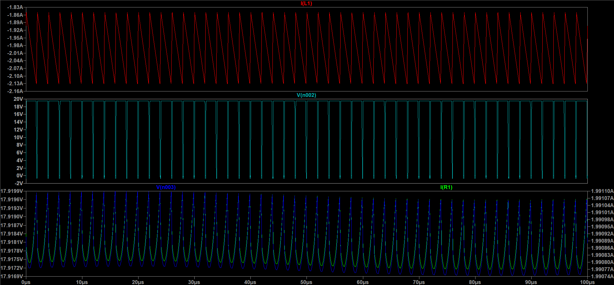
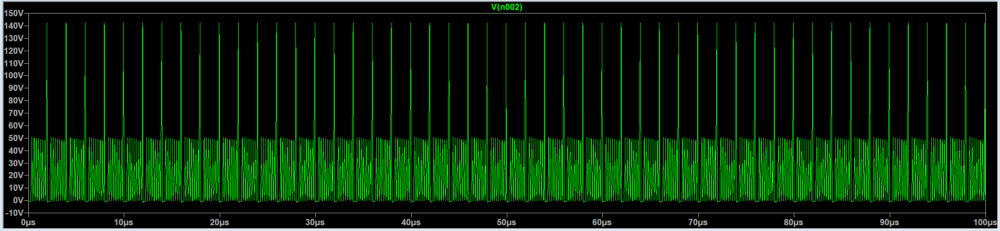
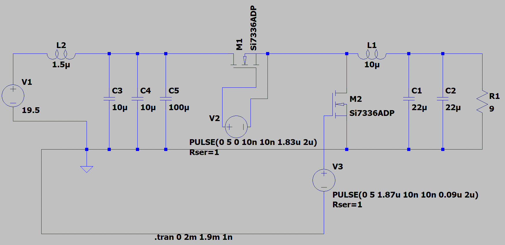
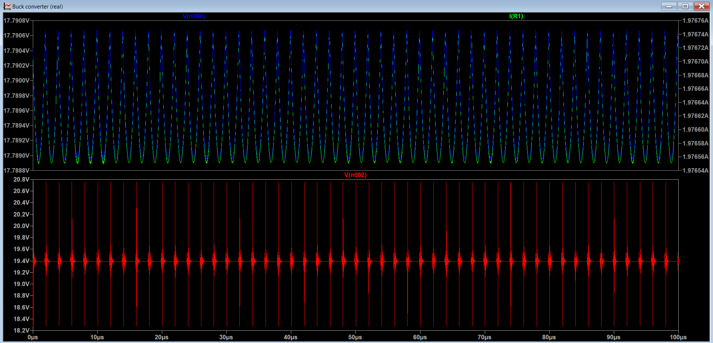
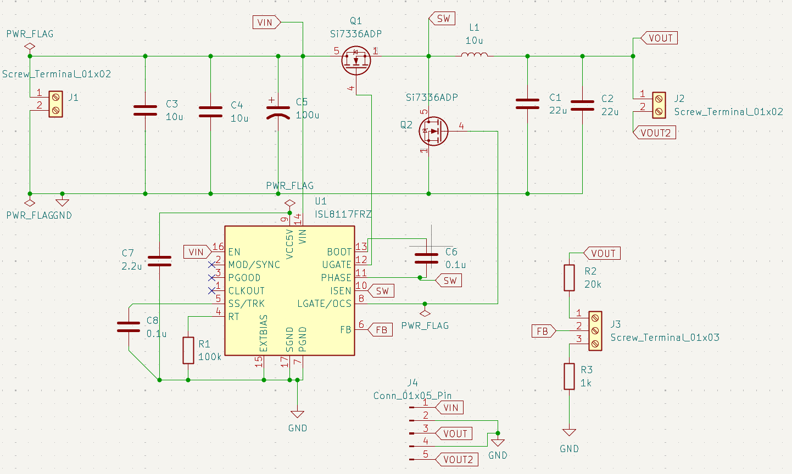
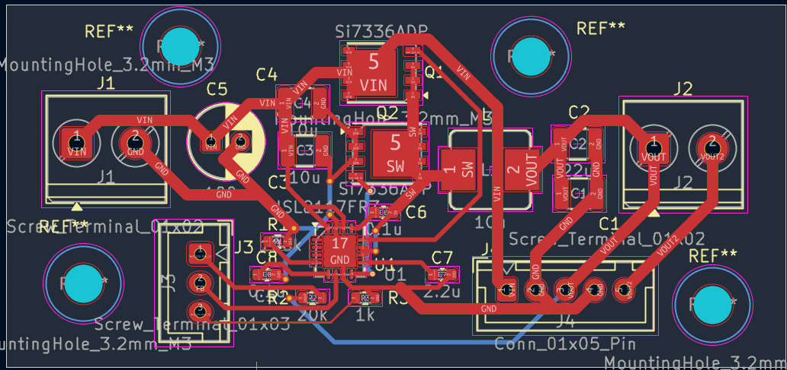
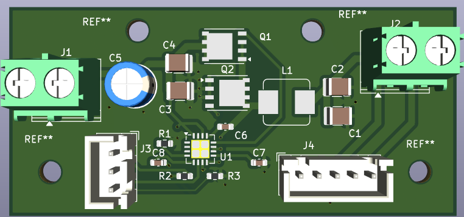

# Adjustable Synchronous Buck Converter (1.2V – 18.0V @ 3A)

A variable bench power supply designed to step down a standard 19.5V laptop charger (HP Omen 16) into an adjustable, low-noise DC output.

---

## 1. Specifications & Design Envelope

| Parameter | Specification | Implementation Notes |
| :--- | :--- | :--- |
| **Input Voltage ($V_{in}$)** | 19.5V DC | HP Omen 16 power brick via screw-terminal pigtail |
| **Output Voltage Range ($V_{out}$)** | 1.2V – 18.0V | Closed-loop potentiometer feedback network |
| **Maximum Output Current ($I_{out}$)** | 3.0A | Saturation-rated power inductor ($I_{sat} \ge 4\text{A}$) |
| **Switching Frequency ($f_{sw}$)** | 500 kHz | Programmed via 100kΩ timing resistor on RT pin |
| **Output Voltage Ripple** | < 30 mV pk-pk | Dual 22µF parallel low-ESR ceramic caps |
| **Target Efficiency** | > 90% | Synchronous rectification using dual NMOS FETs |

---

## 2. Mathematical Sizing & Derivations

??? note "Click to expand Inductor & Capacitor Calculations"
    ### A. Duty Cycle & Timing
    $$D_{max} = \frac{V_{out}}{V_{in}} = \frac{18\text{V}}{19.5\text{V}} = 0.9231 \quad (92.3\%)$$
    $$T_{on} = D_{max} \cdot T = 0.9231 \cdot \frac{1}{500 \times 10^3} = 1.846\,\mu\text{s}$$

    ### B. Inductor Sizing ($L$)
    Targeting a ripple current ($\Delta I_L$) of 30% at max current (3.0A):
    $$\Delta I_L = 0.30 \times 3.0\text{A} = 0.9\text{A}$$

    Worst-case ripple occurs at $D = 0.5$ ($V_{out} = 9.75\text{V}$):
    $$L_{worst\ case} = \frac{(19.5 - 9.75) \cdot 9.75}{19.5 \cdot 500{,}000 \cdot 0.9} = 10.83\,\mu\text{H} \approx \mathbf{10\,\mu\text{H}}$$

    **Inductor Peak / Saturation Margin:**
    $$I_{peak} = I_{out} + \frac{\Delta I_L}{2} = 3.0\text{A} + 0.45\text{A} = \mathbf{3.45\text{A}}$$
    *Selected: Bourns SRP7028A-100M ($10\mu\text{H}$, $I_{sat} \ge 4.0\text{A}$).*

    ---

    ### C. Output Capacitor Sizing ($C_{out}$)
    $$\Delta V_{out} = \frac{\Delta I_L}{8 \cdot f_{sw} \cdot C_{out}}$$
    $$C_{out} \ge \frac{0.9\text{A}}{8 \cdot 500{,}000 \cdot 0.010\text{V}} = \mathbf{22.5\,\mu\text{F}}$$
    *Selected: Two $22\,\mu\text{F}$ 1210 X7R ceramic capacitors in parallel ($44\,\mu\text{F}$ total).*

---

## 3. Simulation & Circuit Progression

### Stage 1: Ideal Switching Baseline
To validate the duty cycle math and filter sizing, the circuit was first modeled using ideal voltage-controlled switches and an ideal DC source.

*Figure 1: Ideal LTspice model confirming target 18V output delivering 2A through a 9Ω load.*

---

### Stage 2: Realistic MOSFET Power Stage & Waveform Verification
The ideal switches were replaced with real Siliconix/Vishay **Si7336ADP** N-channel MOSFETs, incorporating real $R_{DS(on)}$ and parasitic capacitances.

*Figure 2: Power stage schematic utilizing dual Si7336ADP PowerPAK SO-8 MOSFETs.*

*Figure 3: Top to bottom: Inductor ripple current ($I_L$), switch node square wave ($V_{SW}$), and output voltage/current stability.*

**Waveform Analysis:**
* **Inductor Current ($I_L$):** Verified triangular ripple behavior in continuous conduction mode (CCM). Peak current confirmed within the safe saturation margin of the selected inductor core.
* **Switch Node ($V_{SW}$):** Monitored sharp transitions and confirmed gate timing prevented dead-time shoot-through.

---

### Stage 3: The Parasitic Inductance Problem
In practical applications, power is delivered through a ~1.5m laptop cable. Modeling this wire parasitic inductance (~$1.5\mu\text{H}$) combined with 10ns switching edges revealed a severe issue:

*Figure 4: Unfiltered input voltage ($V_{in}$) exhibiting severe $LC$ ringing with inductive spikes exceeding **140V**.*

Because the MOSFETs are rated for $30\text{V}$, these undamped voltage spikes would cause immediate catastrophic breakdown on first power-up.

---

### Stage 4: Input Damping Solution
To clamp input inductive kickback while filtering high-frequency switching currents, a hybrid 3-capacitor network was implemented:
* **High-Frequency Ceramic Decoupling ($2\times 10\mu\text{F}$ 1210):** Positioned immediately at the high-side FET drain to provide transient current and minimize local loop area.
* **Electrolytic Damping ($1\times 100\mu\text{F}$):** Selected for its higher internal ESR to act as an $RC$ snubber, absorbing input energy surges and damping cable resonance.

*Figure 5: Input network incorporating $1.5\mu\text{H}$ cable inductance model and hybrid ceramic/electrolytic decoupling.*

*Figure 6: Regulated input voltage ($V_{in}$) successfully clamped to a stable 19.4V DC rail alongside clean output voltage and current.*

---

## 4. Hardware Implementation & KiCad Schematic

To translate the simulated power stage into physical hardware, the design incorporates a dedicated **Renesas ISL8117FRZ** synchronous PWM controller IC.

*Figure 7: Complete KiCad schematic including controller IC, bootstrap circuitry, feedback divider, and external display headers.*

* **Power Interfacing:** Due to the lack of PCB-mount 4.5mm × 3.0mm barrel jack connectors, heavy-duty 5.00mm Phoenix screw terminals were utilized with a stripped pigtail cable.
* **Closed-Loop Regulation:** JST-XH 3-pin headers route the feedback node to an external panel-mount potentiometer for variable output adjustment.
* **Instrumentation:** 5-pin JST-XH header integrated for an external digital voltage/current panel display.

---

## 5. Bill of Materials (BOM)

| Item | Designator | Qty | Value | Description | Package | Part Number |
| :---: | :--- | :---: | :--- | :--- | :--- | :--- |
| 1 | **U1** | 1 | ISL8117FRZ | Synchronous Buck Controller | QFN-16 (4×4mm) | ISL8117FRZ-T |
| 2 | **Q1, Q2** | 2 | Si7336ADP | 30V 30A N-Channel MOSFET | PowerPAK SO-8 | Si7336ADP-T1-GE3 |
| 3 | **L1** | 1 | 10µH | Shielded Power Inductor ($I_{sat} \ge 4.0\text{A}$) | SMD 7.3×6.6mm | Bourns SRP7028A-100M |
| 4 | **C1, C2** | 2 | 22µF | Output Filter Ceramic, X7R 25V | SMD 1210 | Murata / TDK |
| 5 | **C3, C4** | 2 | 10µF | Input High-Freq Ceramic, X7R 50V | SMD 1210 | Murata / TDK |
| 6 | **C5** | 1 | 100µF | Input Bulk Electrolytic, 50V Low-ESR | Radial THT D6.3mm | Nichicon / Panasonic |
| 7 | **C6, C8** | 2 | 0.1µF | Bootstrap (C6) & Bypass (C8) Caps | SMD 0603 | Standard 0603 |
| 8 | **C7** | 1 | 2.2µF | VCC LDO Decoupling Capacitor | SMD 0603 | Standard 0603 |
| 9 | **R1** | 1 | 100kΩ | Frequency Setting Resistor, 1% | SMD 0603 | Standard 0603 |
| 10 | **R2** | 1 | 20kΩ | Upper Feedback Resistor, 1% | SMD 0603 | Standard 0603 |
| 11 | **R3** | 1 | 1kΩ | Lower Feedback Limit Resistor, 1% | SMD 0603 | Standard 0603 |
| 12 | **J1, J2** | 2 | 2-Pin | Screw Terminal Blocks (5.00mm) | THT Horizontal | Phoenix PT 1,5/2-5,0-H |
| 13 | **J3** | 1 | 3-Pin | Potentiometer Harness Header | JST-XH 2.50mm | JST B3B-XH-A |
| 14 | **J4** | 1 | 5-Pin | LED Panel Meter Connector | JST-XH 2.50mm | JST B5B-XH-A |

---

## 6. PCB Layout & Physical Design

*Figure 8: 2-layer routing with solid ground plane stitching, wide high-current power polygons, and short gate-drive loops.*

*Figure 9: Populated 3D board view showing connector clearance, power stage density, and M3 mounting points.*

* **Continuous Layer 2 Ground Plane:** Uninterrupted bottom copper return under critical high-$di/dt$ switching nodes minimizes radiated EMI and suppresses ground bounce.
* **Thermal Management:** Via stitching arrays adjacent to MOSFET thermal pads and the power inductor transfer heat into internal copper planes.
* **Critical Loop Routing:** Shortened the distance between input ceramic capacitors, high-side drain, low-side source, and ground to minimize high-frequency loop inductance.

---

## 7. Status & Bench Testing Roadmap
- [x] Mathematical calculations and worst-case component sizing[cite: 18, 19].
- [x] LTspice transient modeling and parasitic spike mitigation[cite: 20, 21].
- [x] KiCad schematic capture and 2-layer layout optimization[cite: 22, 23, 24].
- [ ] PCB fabrication and SMD reflow soldering.
- [ ] Oscilloscope verification: switch-node ringing and load step transient response across 1.2V–18V sweep.