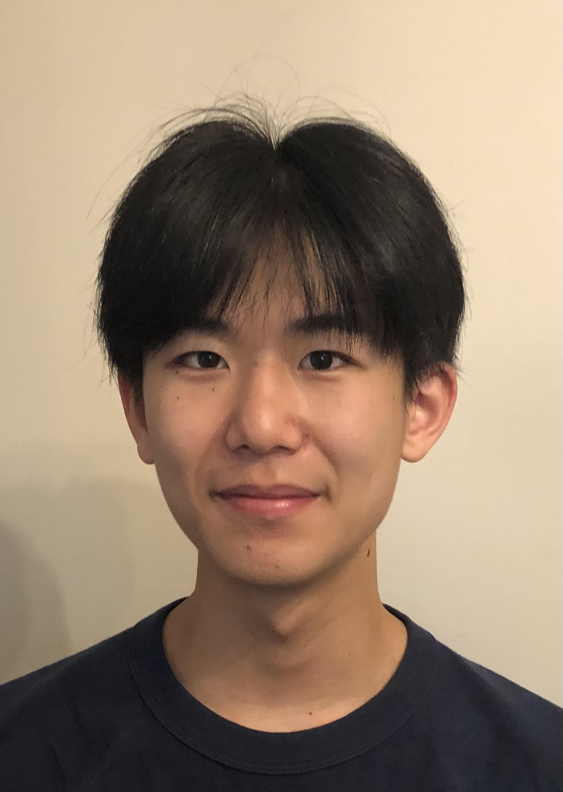

  
  

    <h1>En-Zuo (Andrew) Li</h1>
    

      <strong>B.S. Electrical & Mechanical Engineering</strong> | University of Maryland, College Park (Expected May 2029)[cite: 13]
    

    

      <a href="https://github.com/andrewenzuoli" target="_blank" class="md-button md-button--primary">GitHub</a>
      <a href="https://www.linkedin.com/in/YOUR-LINKEDIN-URL" target="_blank" class="md-button">LinkedIn</a>
    

  

---

## About Me

Welcome to my engineering portfolio! I am a dual-degree student in **Electrical Engineering and Mechanical Engineering** at the University of Maryland. I focus on power electronics, embedded systems, and mechanical hardware design.